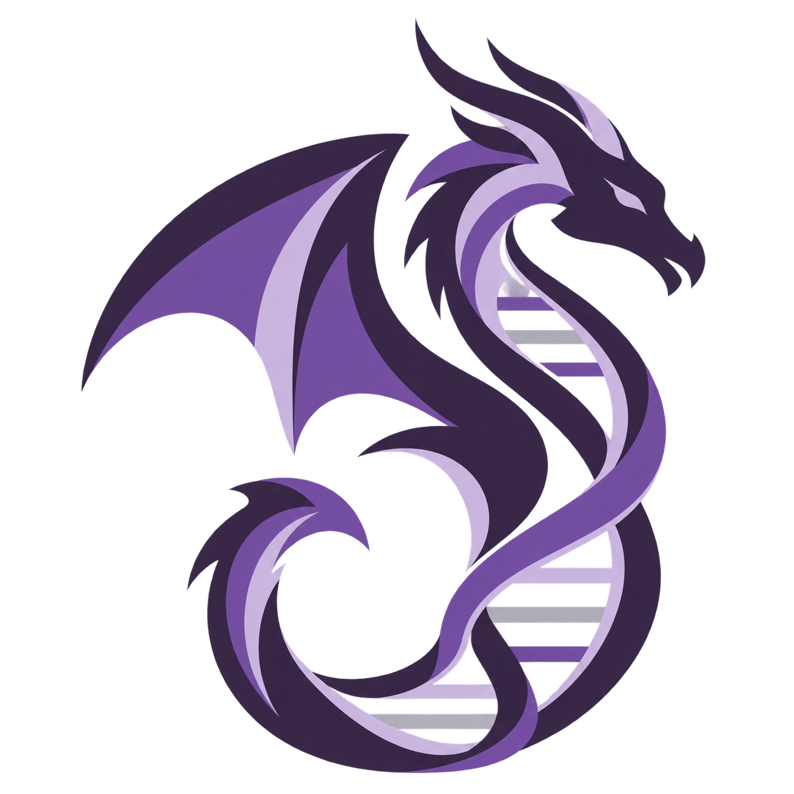

<p align="center">
  
</p>

<h1 align="center">DRAGEN</h1>

<p align="center">BCR::ABL1-varianter fra DRAGEN amplicon · IGV · databaseoppslag · Excel</p>

<p align="center">
  <a href="https://github.com/Christian-Bjornstad/abl1-dragon/actions/workflows/tests.yml"></a>
  
  
</p>

Python-app for mappeimport, gjennomgang av varianter og Excel-rapport med ett ark per valgt prøve/variant.
Analysefiler og IGV behandles lokalt. Offentlig hg19 chr9-referanse og IGV.js følger kildekoden.

## Start på Windows

Krever Python 3.12–3.14, 64 bit.

1. Last ned hele [main-branchen](https://github.com/Christian-Bjornstad/abl1-dragon/archive/refs/heads/main.zip) og pakk ut.
2. Kjør **INSTALL_DRAGEN.cmd**.
3. Kjør **START_DRAGEN.cmd**.

Start og installasjon følger PRONTOs Python FELLES-mønster. På jobb-PC åpnes FELLES via
Ivanti; lim inn med Ctrl+V og trykk Enter. Ved installasjon fra kildekoden hentes de låste
pakkene automatisk. Lukk FELLES etter installasjon før appen startes i et nytt vindu.
Hver Windows-bruker får egne pakker i `%LOCALAPPDATA%\DRAGEN\python-packages`.
Kildekoden kan deles fra fellesområdet; installasjonen flytter ikke delte pakkemapper.

[Installasjon, Python FELLES og Edge](docs/INSTALL.md).
[Første test på jobb-PC](docs/JOBBPC_TEST.md).

## Bruk

Velg analysemappe. Appen finner hard-filtered VCF, tilhørende QC og indekserte
BAM/CRAM-filer. Standardutvalget viser PASS og kodende kontrollkandidater.
Alle opprinnelige kall finnes under **Alle**. Kryss av variantene som skal søkes opp og rapporteres.
**Merk synlige** merker hele det viste utvalget. Merking beholdes når listen filtreres.

Velg variant og åpne **IGV** i venstremenyen. På Windows åpnes lesningsvisningen i
et eget vindu med PC-ens Microsoft Edge, med standardzoom og 200 bp-oversikt.
Ingen egen Chromium-/QtWebEngine-prosess trengs. Dekning, grå lesninger med baseavvik,
referansesekvens og NM_005157.6 gen-/proteinspor vises lokalt.
Analysesiden har en hendelseslogg. Medfølgende `chr9.fa.gz` og `.fai` klargjøres
automatisk under installasjon eller første start. IGV trenger ingen referansenedlasting.
En annen GRCh37/hg19 FASTA kan velges i **Innstillinger**.
Referansen kontrolleres mot hg19 chr9 før lesningene vises.

**Søk i databaser** slår opp merkede alleler. Samme allel i flere prøver søkes én gang.
Kort kildestatus vises under variantlisten. Innstillinger samler kildevalg og innlogging.
Resultater vises og lagres kilde for kilde. Tidligere oppslag og bilder hentes tilbake
når samme allel åpnes igjen; tidspunktet følger resultatet. Et nytt søk henter nye svar.
E-post og passord lagres i Windows Credential Manager per lokal appdatamappe. Passord
ligger ikke i innstillingsfilen og fylles bare inn i kontrollerte innloggingsskjemaer
på riktig databasevert. MFA og endrede/eksterne SSO-skjemaer fullføres i Edge.
**Glem** fjerner den lagrede innloggingen; aktive nettstedssesjoner kan fortsatt være innlogget.
Opplysninger skrevet før **Åpne / logg inn** lagres automatisk. Appen venter på
bekreftet innlogging etter innsending. En lagret OncoKB-konto brukes før variantsøket.
Prøvenavn, VCF og alignments sendes ikke til databasene.

**Eksporter Excel** lager én fil per prøve: `<prøvenavn>_DRAGEN_Resultater.xlsx`.
Ved flere prøver velges en målmappe. Hver fil har ett ark per merket variant,
navngitt etter proteinvarianten, uten oversiktsark.
AF, ALT/DP, FILTER, kildeinformasjon og tilgjengelige kildebilder følger med.
Et standardbilde av riktig prøves IGV tas automatisk for hver variant under eksporten.
Ulike prøver får hver sin fil. Manglende bilde/tilgang angis i variantarket.
Databasebilder tas bare når nettsiden bekrefter riktig allel; et treff i tekst alene er
ikke tilstrekkelig. Kildestatus viser om bildet er klart. Etter innlogging eller
nettleserkontroll: velg varianten og trykk **Hent bilder fra åpne sider**.
Knappen bruker de åpne databasesidene uten å starte søket på nytt.
Databaseoppslag krever nett og eventuell konto/tilgang.
[Kilder og bildeuttak](docs/DATABASES.md).
Franklin-bilder omfatter tilgjengelige ACMG-/onkogenisitetsvisninger, evidenskort,
prediksjoner og populasjonsfrekvenser. Manglende delbilder angis i rapporten.
MTBP sender én variant per analyse med et tilfeldig DRAGEN-ID og sykdomskategorien
**Blood**. Prøvenavnet sendes ikke. Ved **Analyse venter**: søk igjen for å hente
samme analyse. Egen MTBP-rapport beholdes i portalen; appen sletter ingen rapporter.
MTBP-rapporten angir om kildetreffet er basert på protein eller cDNA.

Annotasjon bruker GRCh37/hg19 og NM_005157.6. PASS er caller-status.
Kontrollkandidater er teknisk sortering uten validert deteksjonsgrense.
VCF alene dokumenterer ikke fase eller dekning ved negative posisjoner.
Appen er ikke klinisk validert. Medfølgende tester og CLI-selvtesten bruker syntetiske data.
[Metode og avgrensning](docs/METHOD.md).

Prøvefiler, prosjekter og nettleserprofiler lagres utenfor repoet.

## Utvikling

```cmd
python -m venv .venv
.venv\Scripts\python -m pip install -r requirements-desktop.txt
.venv\Scripts\python start_abl1.py
.venv\Scripts\python -m unittest discover -s tests -p "test_*.py"
```

Valgfrie lesningstester med pysam på Linux:
`python tests/optional/read_evidence_checks.py`.

GPL-3.0. Se [LICENSE](LICENSE) og [tredjepartsressurser](docs/THIRD_PARTY.md).
