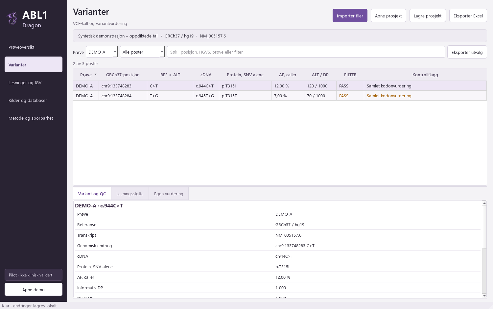

# ABL1 Dragon

Python-app for gjennomgang av BCR::ABL1-varianter fra DRAGEN amplicon.
Lilla/grå arbeidsflate med VCF-import, QC, variantnotater, prosjektlagring og Excel-eksport.

Demoen er syntetisk. Appen er en pilot og er ikke klinisk validert.



## Start på Windows

Krever Python 3.12–3.14, 64 bit.

1. Last ned og pakk ut [offline-pakken](https://github.com/Christian-Bjornstad/abl1-dragon/releases/latest).
2. Kjør **Installer ABL1.cmd**.
3. Kjør **Start ABL1.cmd**.

[Installasjon, Python FELLES og Edge](docs/INSTALL.md).

## Bruk

Importer VCF/VCF.gz, en DRAGEN-mappe med QC eller en analyse-JSON.
Bekreft GRCh37/hg19. Annotasjon bruker NM_005157.6.

Velg prøve og variant, kontroller kvalitet og lesningsgrunnlag, og skriv vurdering.
Lagre prosjekt for videre arbeid eller eksporter Excel. Kildelenker åpnes i egen
Edge-profil ved klikk; konto og MFA håndteres i nettleseren.

VCF alene dokumenterer ikke fase eller dekning ved negative posisjoner.
Demoen inneholder ingen alignments eller IGV-bilder. Ny BAM/CRAM-analyse og nye
IGV-rapporter kjøres foreløpig utenfor GUI-et.
[Metode og avgrensning](docs/METHOD.md).

Prøvefiler, prosjekter, nettleserprofiler og vurderinger skal lagres utenfor repoet.

## Utvikling

```cmd
python -m venv .venv
.venv\Scripts\python -m pip install -r requirements-desktop.txt
.venv\Scripts\python start_abl1.py
.venv\Scripts\python -m unittest discover -s tests -p "test_*.py"
```

Valgfrie lesningstester med pysam på Linux:
`python tests/optional/read_evidence_checks.py`.

GPL-3.0. Se [LICENSE](LICENSE) og [tredjepartsressurser](docs/THIRD_PARTY.md).
